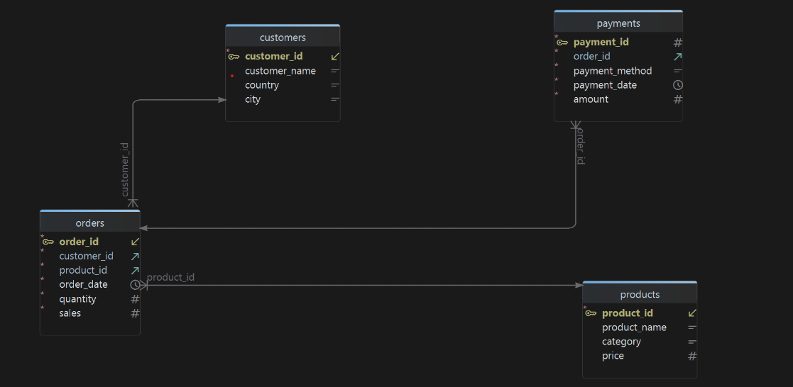
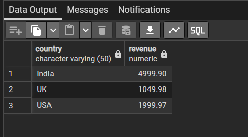
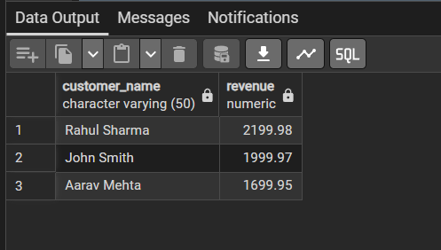
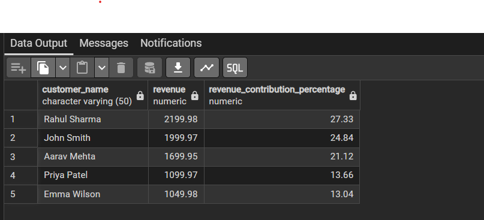
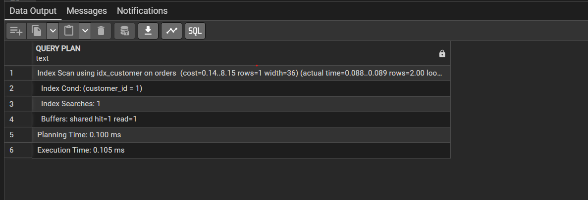

# E-Commerce Analytics Platform

A PostgreSQL-based analytics project designed to analyze customer, product, order, and payment data.

This project demonstrates:

- Database design
- SQL analytics
- CTEs
- Window functions
- Views
- Indexes
- Query optimization using EXPLAIN ANALYZE

## Tech Stack

- PostgreSQL
- SQL
- pgAdmin
- Git
- GitHub


# E-Commerce Analytics Platform

## Database Schema



## Tables

- customers
- products
- orders
- payments

## Relationships

- One customer can place many orders.
- One product can appear in many orders.
- One order has one payment.


## Business Questions Solved

1. Total Revenue
2. Revenue by Country
3. Revenue by City
4. Daily Revenue Trend
5. Cumulative Revenue
6. Top Customers
7. Customer Lifetime Value
8. Customers Above Average Revenue
9. Repeat Customers
10. Customer Revenue Contribution %
11. Top Products by Revenue
12. Top Products by Quantity Sold
13. Revenue by Category
14. Average Product Revenue
15. Product Revenue Ranking
16. Revenue by Payment Method
17. Most Popular Payment Method
18. Average Transaction Value
19. Payment Revenue Contribution
20. Daily Payment Volume
21. Customer Ranking
22. Highest Revenue Customer Per Country
23. Running Revenue Total
24. Revenue Difference From Average
25. Revenue Growth %
26. Top Customer Per City
27. Revenue Share By Category
28. Rolling 3-Day Revenue
29. Customer Purchase Frequency
30. Average Days Between Purchases


## Sample Insights

### Revenue By Country



### Top Customers



### Revenue Contribution %



### Query Optimization




## Project Structure

```text
sql/
├── create_tables.sql
├── insert_data.sql
├── business_queries.sql
├── views.sql
└── indexes.sql

docs/
└── schema.png

screenshots/
├── revenue_by_country.png
├── top_customers.png
├── contribution_percentage.png
└── explain_analyze.png


